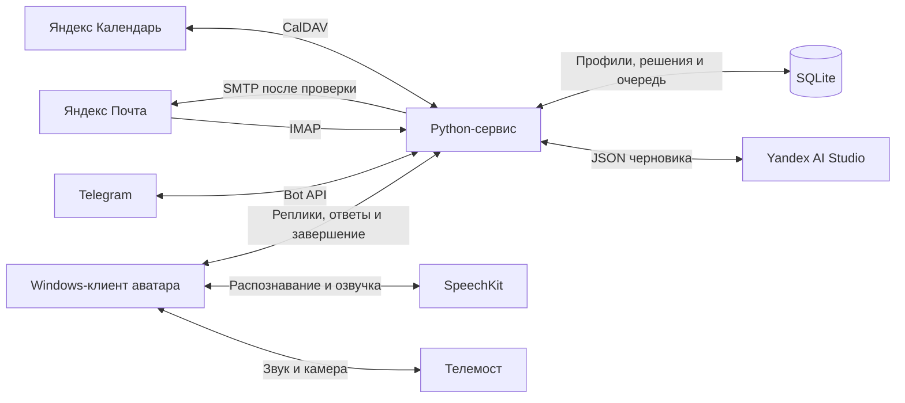

# Контракт общего сервиса

[К командному плану](TEAM_PLAN.md) · [Синтетические JSON-примеры](CONTRACT_EXAMPLES.json)

## Где работает каждая часть

Сервис держит данные и выполняет сценарий. Windows-клиент аватара работает рядом с Телемостом. В комнату в MVP входит оператор под тестовым именем «ИИ-помощник». Реакцию генерирует сервис, звук и видео подаёт клиент. Если у команды получится автоматический вход через разрешённый путь после проверки, это отдельный этап. Операторский вход и способ выделения реплики укажите на защите.

## 1. Среда запуска и владение файлами

| Владелец | Файлы, за которые отвечает | Публичная точка входа |
| --- | --- | --- |
| Основа | `app/main.py`, `app/core/`, `app/contracts.py`, `app/ports.py`, `app/adapters/model.py`, `migrations/`, `tests/core/`, `pyproject.toml`, `.env.example`, README | Сборка модулей, CLI, CLI-импорт профилей, общий исполнитель, модели типов |
| Почта | `app/mail/`, `tests/mail/` | `poll_once`, `classify_mail`, `send_email`, пакетная оценка |
| Telegram | `app/telegram/`, `tests/telegram/` | `poll_updates`, `notify`, `handle_update` |
| Аватар | `app/meetings/`, `avatar_client/`, `tests/meetings/` | HTTP-роутер и настольный запуск |
| Протокол и планы | `app/workflow/`, `app/calendar/`, `tests/workflow/` | `generate_minutes`, `build_plan`, операции задач и календаря |

Основа подключает модули в `main.py`, принимает добавления в список зависимостей и владеет миграциями. Каждый модуль может иметь локальный тестовый адаптер. Общие типы редактируются в PR владельца основы после согласования. Имя пакета `app`, запуск `python -m uvicorn app.main:app --workers 1`, проверки `python -m pytest -q`. CLI первого PR должен дать `python -m app seed-demo` и `python -m app smoke`. Команду `python -m app retry-effect <id>` добавить во втором PR основы вместе с исполнителем внешних операций. Автоматика включается флагом профиля и среды. На машинах разработки используются синтетические фикстуры, временный SQLite и тестовые адаптеры.

На стенде один Uvicorn worker, один цикл Telegram, опрос каждого включённого IMAP и один исполнитель очереди. Блокирующие вызовы IMAP, SMTP и CalDAV выполнять вне event loop с таймаутом. Использовать короткие транзакции, включить `foreign_keys=ON` и `busy_timeout` для каждого соединения, WAL на локальном диске. SQLite хранится на постоянном томе. Остановка процесса не удаляет очередь и входящие события. Публичный HTTP доступен через HTTPS. Данные и операционные маршруты закрыты, открытый `/health` возвращает только состояние процесса.

## 2. Настройки и данные

Приватная конфигурация профиля содержит ID, часовой пояс IANA, локальное время плана, рабочие дни, включённые каналы, ссылку на подключения, Telegram ID руководителя, карту ролей и получателей, правила маршрутизации и сохранённые правила черновиков. Один Telegram ID может быть привязан к разным профилям, выбор для ручной команды тогда явный. Карточка всегда привязана к одному запросу. У второго профиля для живой демонстрации собственный ящик или отдельное IMAP-подключение с однозначной привязкой, собственный календарь и свои получатели. Для независимой разработки достаточно двух синтетических профилей. Часовой пояс хранить в профиле, моменты — в UTC, сроки без времени — как локальные даты. Рассчитывать «предыдущий рабочий день» по рабочим дням профиля.

| Таблица | Основные поля и ограничения |
| --- | --- |
| `profiles`, `bindings` | ID профиля и настройки, тип и ID подключения, TG ID, роли, привязка к назначенному календарю. Секреты по ссылкам на имена переменных окружения |
| `inbox_events` | Профиль, источник, внешний ключ, принятый payload, статус и время. Уникальность `(profile_id, source, external_key)` |
| `meetings`, `meeting_turns` | Профиль, встреча, инициатор, участники, контекст прошлого протокола, состояние. Номер реплики и ID запроса уникальны в сессии. Хранить текст ответа для повтора |
| `documents`, `document_versions` | Профиль, тип `mail_action` или `minutes`, ссылка на источник, текущая версия, статус. Неизменяемое содержимое версии с получателями и поручениями |
| `approvals` | Случайный ID запроса, профиль, документ и версия, допустимая роль или пользователь, состояние, решение и время. Один действующий запрос на версию |
| `tasks`, `preferences` | Профиль и внешний или внутренний ID, исполнитель, срок, статус, исходная версия. Правки стиля хранятся отдельными записями профиля |
| `effects` | Профиль, утверждённая версия либо автоматический источник, тип, один адресат/поручение, payload, ключ, состояние, lease, число попыток, следующий запуск, внешний ID и код ошибки |
| `audit_log` | Профиль, объект и версия, правило, источник, действующий пользователь, время, результат. Проверять доступ при просмотре |
| `cursors` | Стабильный ID источника и позиция. Позиция IMAP включает папку, UIDVALIDITY и UID. Telegram — ID бота и update ID |

Во всех выборках по пользовательским объектам обязательна область профиля. Локальные ID нельзя разыменовывать без профиля. Проверяемые связи между сущностями привязывать к паре `(profile_id, id)`. Пакетная оценка читает эталонные поля отдельно и не пишет новые письма, эффекты или задачи на стенд.

## 3. Общие типы и вызовы

Между модулями одного процесса обычные функции Python. HTTP только для клиента аватара и проверки состояния. Общие Pydantic-модели задаёт владелец основы. Добавления опциональных полей согласуйте в одном PR. Внешний вход ограничить размером и проверять типы. Неизвестные обязательные значения идут на уточнение.

| Вызов | Вход → выход | Владелец |
| --- | --- | --- |
| `receive_mail(channel_id, receipt)` | UID и нормализованное письмо → ID входящего события и результат регистрации. Профиль выводится из `channel_id`. | Основа принимает, почта вызывает |
| `classify_mail(mail, context)` | Тема, текст и известный отправитель → `topic`, `requires_review`, `rationale`, текст черновика. Маршрут, права и разрешённый адресат определяются правилами сервера. | Почта |
| `propose(profile_id, source_key, candidate)` | Доверенный профиль, тип источника, результат проверок и данные черновика → ID документа, версия и статус. Однократная запись по источнику. Общий сервис выбирает согласование или разрешённый автоматический маршрут. | Основа, вызывают обработчики письма и встречи |
| `revise_document(document_id, actor, expected_version, patch)` | Проверенный автор и ограниченный набор изменяемых полей → новая версия и новый запрос. Старую карточку закрыть. Несовпадение версии или полномочий возвращает ошибку. | Основа, вызывает Telegram |
| `save_preference(profile_id, actor, text, source_ref)` | Явное действие руководителя и повторяемое правило → ID настройки его профиля. Текст письма или встречи сам по себе правило не сохраняет. | Основа, вызывает Telegram и использует workflow |
| `decide(approval_id, actor, decision, comment)` | Подтверждённый Telegram ID и три допустимых действия → `accepted`, `already_decided`, `stale`, `forbidden` или `validation_error`. | Основа, вызов Telegram |
| `submit_transcript(session, turns)` | Сессия, текст реплик, метки времени и роли → ID встречи и ключ работы над протоколом. | Основа/аватар |
| `generate_minutes(meeting, turns, preferences)` | Проверенный контекст → `summary`, `decisions[]`, `open_questions[]`, `tasks[]`, ссылки на фрагменты, при необходимости поля для уточнения. | Протокол |
| `build_plan(profile_id, date, period)` | Локальная дата и `day\|week` → встречи, сроки, просрочки, итоги прошлого рабочего дня, статусы и решения, ожидающие руководителя. | Протокол и планы |
| `send_email(effect)`, `publish_task(effect)`, `upsert_event(effect)`, `notify(effect)` | Неизменяемый payload эффекта → `sent\|retryable\|unknown\|failed`, внешний ID и безопасный код ошибки. | Почта, протокол, календарь, Telegram |
| `model.generate_json(schema, messages)`, `model.reply(messages)` | Тип ответа плюс минимальный контекст → проверенный объект или короткий текст. Права и вызов внешних действий не входят в интерфейс модели. | Основа |

В JSON-примерах вход и эталон лежат в разных секциях. Поле `action_effects_before_approval` считает эффекты предлагаемого действия. Служебная карточка согласования в Telegram в этот счёт не входит. В реальном прогоне загрузчик передаёт классификатору поля письма без fixture ID и эталона. Имя маршрута — код из закрытого набора (`forward_sales`, `forward_service`, `record_status`, `ignore`, `review`, `check_calendar`). Категории обязательного контроля (`finance`, `hr`, `customer_commitment`, `executive_mail`) и неопределённость всегда имеют приоритет. После калибровки на тестовых письмах добавлять новые ярлыки только вместе с явным правилом. Операции в очереди используют коды `email`, `telegram`, `task`, `calendar_event`.

Общие действия согласования `approve`, `reject`, `revise`. Черновик поручения содержит `task_ref`, `action`, `assignee_ref`, `due_date`, `status`, `source_turn_ids`. Неизвестные исполнитель и срок — `null`. После утверждения каждое поручение выполняется только с разрешённым и проверенным исполнителем и сроком. Неполные поля остаются явно обозначенными, интерфейс предлагает уточнение.

## 4. Точка соединения с аватаром

Администратор стенда заранее создаёт сессию встречи через закрытую CLI-команду, связывает её с профилем и инициатором, выдаёт случайный ограниченный по времени токен. Хранить хеш токена. Клиент отправляет `Authorization: Bearer <session_token>` по HTTPS. Профиль определяется токеном. При несовпадении токена и ID встречи не раскрывать существование встречи.

- `GET /health` → `{"status":"ok"}`.
- `POST /v1/meetings/{meeting_id}/start` с `{"request_id":"start-1"}` → `{"reply_text":"Я ИИ-помощник. Скажите, выполнено ли поручение по тестовой поставке?"}`. Приветствие и вопрос сохраняются.
- `POST /v1/meetings/{meeting_id}/turns` с `{"request_id":"turn-1","sequence":1,"text":"Поставка будет в четверг","role":"participant"}` → `{"sequence":1,"reply_text":"Понял. Кто подтвердит срок в четверг?","approval_required":false}`. Маршрут принимает только роль участника. Ответы ассистента, инициатор и права определяются сервером. При повторе ID возвращает сохранённый ответ. Тот же ID с другим текстом или конфликт последовательности дают 409. Одновременно у сессии обрабатывается одна реплика.
- `POST /v1/meetings/{meeting_id}/finish` с `{"request_id":"finish-1"}` → HTTP 202 и `{"status":"queued","meeting_id":"demo-meeting"}`. Генерация протокола идёт через сохранённую работу. Повтор завершения не запускает новый протокол.
- Ошибки возвращают `{"code":"invalid_state","message":"…"}`. Основные статусы 401, 409, 422 и 503. В логи выводить код и ID корреляции без токена и содержания разговора.

Фразы клиента считаются недоверенным вводом. Модель может предложить чувствительный вопрос, сервис фиксирует его для руководителя. Аватар не меняет задачи или календарь из разговора. Если ответ модели не получен, клиент сообщает короткое нейтральное сообщение и сохраняет поступившую реплику для протокола. Если потеряно сетевое подтверждение, клиент повторяет тот же ID запроса. Сырой звук хранится только при явной необходимости и согласии участников.

## 5. Состояния и доставка

1. У события есть устойчивый ключ: для почты `connection:folder:UIDVALIDITY:UID`, для Telegram `bot:update_id`, для встречи `meeting:request_id`. Сначала записать вход, затем продвигать курсор. Валидированный, но ещё не обработанный вход остаётся в SQLite.
   Общий цикл сначала захватывает необработанное событие по устойчивому ключу. Для письма вызывает классификатор, для завершённой встречи — `submit_transcript` и генерацию протокола из сохранённых реплик. Затем единый `propose` атомарно сохраняет документ, итог обработки и зарезервированные операции. Модель вызывается вне транзакции. После падения процесс повторно обрабатывает вход, а уникальный ключ предложения предотвращает дубль документа или карточки. Ошибка генерации сохраняется и ограниченно повторяется. После создания запроса общий сервис планирует отдельное служебное уведомление об ожидании решения, которое доставляет Telegram. Эта карточка не выполняет предлагаемое действие.
2. Неуверенное письмо, четыре чувствительные категории и протокол дают версию `pending_approval`. Руководитель утверждает чувствительное действие, инициатор утверждает протокол. Обязательная политика имеет приоритет над предлагаемым маршрутом модели и правилом профиля. Для автоматических маршрутов требуются явное разрешающее правило, известный получатель из конфигурации и отсутствие сигналов чувствительности. Неизвестный ярлык, конфликт проверок и истёкший таймаут ведут к ручному решению. Фактический получатель берётся из проверенной конфигурации или утверждённой версии.
3. `decide` проверяет профиль, роль, актуальную версию и состояние. В одной транзакции меняет статус, пишет журнал и планирует эффекты. Отклонение и возврат на правку эффектов не создают. Комментарий привязан к автору и версии. Изменение текста, адресата, исполнителя или срока сохраняется новой версией. Если все эффекты утверждённой версии ещё не начинались, в той же транзакции отменяем их и запрашиваем новую версию. Когда отправка началась, фиксируем её результаты и оформляем коррекцию отдельным черновиком. Уже отправленное второй раз не запускаем автоматически.
4. Ключ эффекта включает профиль, источник, версию, вид и адресата/ID задачи. Например `p1:minutes:m7:v2:email:participant-2`. Автоматическое КП использует утверждённое профилем правило и уникальный источник IMAP. Для планового сообщения ключ включает профиль, локальную дату и период. Ручной просмотр плана отвечает на конкретный update ID.
5. Эффект `pending → sending → sent | retryable | unknown | failed`. Отмена ещё не начатой операции ставит терминальный `cancelled`. Захват атомарный и фиксируется до сетевого вызова. При перезапуске просроченная `sending` становится `unknown`. При явной временной ошибке задать ограниченное число повторов с паузой. HTTP 429 учитывает срок повтора провайдера. При неизвестном результате сначала сверить провайдера. SMTP Message-ID полезен для сверки, но не гарантирует отсутствие дубля. При невозможности сверки оператор фиксирует решение перед повтором. Внутреннее поручение создаётся один раз по ключу. Для CalDAV использовать стабильный UID, по возможности стабильный URI ресурса и условную запись. Повтор сверяет содержимое существующего события.
6. Время расписания 08:30 по профилю. Цикл проверяет локальное время и устойчивый ключ плановой отправки. Для демо ручной запуск с синтетической датой. При подъёме стенда позже условие отправки за пропущенный день фиксируется настройкой. По умолчанию не отправлять устаревшие планы.

## 6. Общие проверки

| Проверка | Наблюдаемый результат |
| --- | --- |
| Тестовый запуск на чистой машине | Команды из README поднимают API и демо-данные без ключей. Фиктивные адаптеры сохраняют следы вызовов. |
| Письма | `m001` ждёт руководителя, `m002` доставлено тестовому исполнителю ровно один раз. На пакете 80 писем посчитаны ошибки и чувствительные классы. |
| Карточка | Чужой пользователь, чужой профиль, устаревшая версия, два согласования одновременно и повтор update не создают лишнего эффекта. |
| Встреча | В соседнем устройстве слышен ответ на непредвиденную реплику. После завершения появляется одно согласование протокола. |
| Публикация | Письмо, поручение и календарное событие имеют собственные статусы. После сбоя в календаре письмо и задача остаются выполненными. |
| Перезапуск | Входящие и эффекты сохранены. Исход с потерянным ответом помечен для сверки. |
| Два профиля | Одинаковые входные данные различаются правилами. Чужие базовые записи и правки закрыты. |
| Демо | Ручной план за дату набора, расписание, сохранённая правка, утверждённая версия, живые получатели и измерения. |

Перед выпуском зафиксируйте отдельно результаты автоматического smoke, реальных провайдеров и совместной репетиции. Тестовые отправки допускаются только в собственные тестовые каналы с явным разрешением. Для публичного репозитория используются разрешённые синтетические данные.
